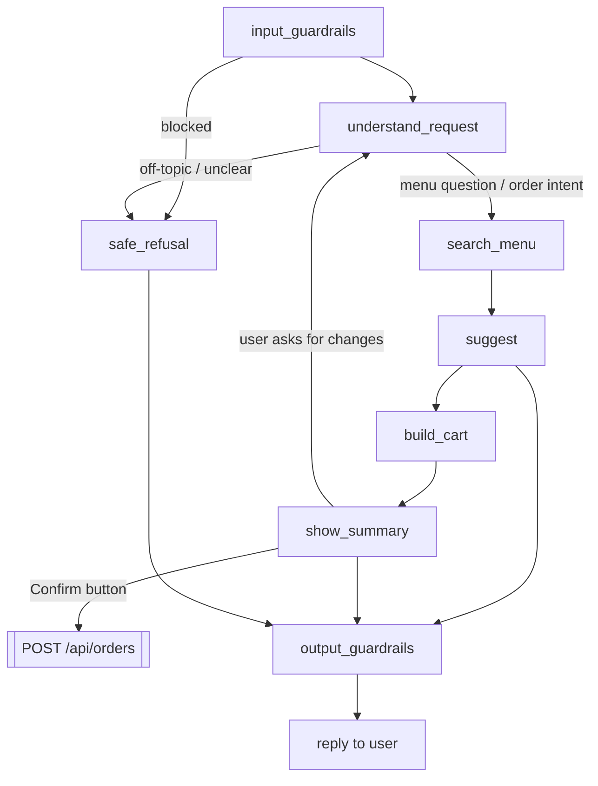

# Architecture

## 1. Components

```
Next.js frontend  ──HTTP──▶  FastAPI backend ──▶ LangGraph (order flow)
                                  │                    │
                                  │                    ├─▶ llm_router ─▶ Groq (model A → B → C)
                                  │                    ├─▶ Embedding service (OpenRouter | local)
                                  │                    └─▶ Guardrails (input / output)
                                  ▼
                       PostgreSQL + pgvector
        (menu, embeddings, sessions, carts, messages, orders)
```

| Component | Responsibility |
|---|---|
| Frontend | Chat UI, receipt-style summary card, Confirm button, dine-in/takeaway form, simple staff page |
| FastAPI | Endpoints, session handling, validation, cart mutations, idempotent order placement, staff endpoints |
| LangGraph | Conversation state machine; holds the cart in state, persisted per session |
| `llm_router` | Ordered model list from config; fallback on 429/timeout; logs fallbacks |
| Embedding service | `embed(texts) -> vectors` interface with OpenRouter and local implementations |
| Guardrails | Input checks before the graph, output checks before the reply |
| Postgres + pgvector | Source of truth for facts and vectors |
| Ingestion script | Excel to validated rows, LLM field extraction, embeddings |

## 2. Core principles

1. **Facts from the database, relevance from vectors.** Filter on structured fields first (`is_available`, `is_veg`, category), then rank by similarity.
2. **The LLM never does arithmetic.** It chooses items and quantities; Python computes line totals and the final amount from DB prices.
3. **The LLM never places orders.** Confirmation is a button calling `POST /api/orders`.
4. **Empty means unknown.** Missing fields lead to "not specified, please check with staff."
5. **Swappable providers.** Embeddings and LLMs sit behind small interfaces.

## 3. LangGraph flow



**State (persisted per session):** `session_id`, `messages`, `intent`, `candidates`, `cart` (item_id, quantity, special_request), `order_type`, `table_number`, `contact`, `stage`.

The Confirm step exits the graph: the frontend calls the order endpoint, which re-validates the cart against the database and writes the order. UI quantity/special-request changes use `PATCH /api/cart/{session_id}` directly; they do not need an LLM round trip.

## 4. Retrieval

1. Parse the request into a semantic query and structured filters (e.g., vegetarian, category).
2. SQL: `WHERE is_available = true AND <filters>` joined to embeddings, `ORDER BY embedding <=> query_vector LIMIT k`.
3. Return top-k candidates (with price and dietary fields from the relational table) to the suggest node.

One embedding per item, built from a text such as "name. description. category. ingredients." No chunking.

## 5. Cart mutation and concurrency

1. The frontend reads the cart and its integer `version`.
2. Quantity steppers and special-request fields call `PATCH /api/cart/{session_id}` with the desired line values and `expected_version`.
3. In a database transaction, the backend validates the item and quantity, recalculates totals from database prices, and updates the cart only when the stored version still equals `expected_version`; it increments the version on success.
4. If two updates race, only the first update against a given version succeeds. The other receives `409` with the latest cart/version and the frontend refreshes/reconciles rather than silently overwriting newer state.

This compare-and-swap approach is sufficient for the single-cafe v1 workload and avoids adding a separate distributed locking system.

## 6. Order placement and idempotency

1. Frontend sends session id, order type, table number or contact, and a unique `Idempotency-Key` for the confirmation attempt.
2. Backend checks whether that key has already been used by the session. If the same request was completed, return the original order response; if the key was reused with a different payload, return `409`.
3. In one database transaction, backend locks/reads the cart consistently, re-checks availability, recomputes prices from the DB, and inserts `orders`, `order_items` (with name and price snapshots), and the idempotency record.
4. If anything changed (unavailable item), return a conflict response and the chat handles it; do not record a successful idempotent result for a failed placement.
5. Return the confirmation payload. The UI states staff will share the final bill and QR.

The unique idempotency constraint is the final protection against duplicate orders when the user retries after a timeout or double-clicks Confirm.

## 7. Session and staff security

A UUID session ID is an opaque, hard-to-guess identifier, not authentication by itself. Generate it securely, validate the session on every customer request, scope all cart/order reads and writes to that session, and rate-limit session creation and mutation endpoints as well as chat. The shared staff API key is the v1 baseline; individual staff authentication and role-based permissions can be considered later if staff access expands.

## 8. Data retention

Apply a 30-day default retention period to chat messages and customer contact details. A scheduled cleanup task should delete expired chat messages and clear/anonymize contact details on orders after the period, while retaining non-identifying order records needed for cafe operations. Make the period configurable and decide/document any operational or legal exception before launch.

## 9. Model routing

`backend/config/llm_models.yaml` holds an ordered list (provider, model, timeout). The router tries each in turn on a 429, timeout, or 5xx, and logs every fallback to `llm_fallback_log`. It rotates across models and providers, not across multiple free accounts, which may breach provider terms. If all fail, the user sees a friendly "please try again shortly" message.

## 10. Guardrails

Lightweight: code validation plus a small classifier prompt. Details in `conversation-design.md`.

## 11. Tech choices and rationale

| Choice | Why |
|---|---|
| pgvector over ChromaDB | Already using Postgres; one DB, one backup, joins between menu data and vectors |
| HNSW index | Candidate approximate-nearest-neighbor index; benchmark against exact search on the actual menu before relying on it, since a few hundred menu items may not justify index overhead |
| LangGraph | The order flow is naturally a state machine with a loop |
| FastAPI | Async, typed, auto-generated `/docs` |
| Groq | Fast inference, free tier |
| Local embedding fallback | Free, adequate for a few hundred menu items |

## 12. Deployment (suggested)

Local Docker for Postgres during development. Free hosted Postgres with pgvector (Supabase or Neon) for demos. Backend and frontend on any free app host. Secrets via environment variables.
